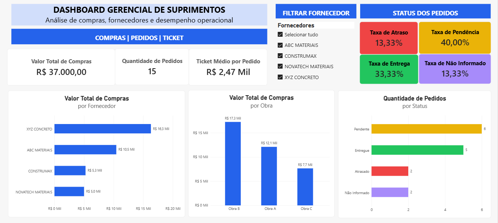

# 📊 Dashboard Gerencial de Suprimentos

## Visualização do Dashboard

**Projeto de Business Intelligence | Power BI • Power Query • DAX**

## Objetivo
Desenvolver um dashboard interativo para analisar compras, fornecedores, obras e o status dos pedidos, apoiando decisões gerenciais na área de suprimentos.

## Problema de negócio
Dados de compras distribuídos em diferentes planilhas dificultam o acompanhamento dos pedidos, a identificação de inconsistências e a análise de desempenho operacional.

O projeto simula a consolidação dessas informações em uma solução única de BI.

## Tecnologias utilizadas
- **Excel:** bases de dados de origem.
- **Power Query:** limpeza, transformação, consolidação e auditoria.
- **Power BI:** modelagem e visualização de dados.
- **DAX:** criação de indicadores e medidas dinâmicas.

## Etapas do desenvolvimento
1. Importação e tratamento das bases de dados.
2. Identificação de duplicidades e informações ausentes.
3. Consolidação dos pedidos e cadastro de fornecedores.
4. Modelagem dimensional com tabelas fato e dimensão.
5. Criação de medidas DAX e indicadores gerenciais.
6. Construção de gráficos e filtros interativos.
7. Validação dos resultados e teste de atualização.

## 📈 Indicadores desenvolvidos

| Indicador | Resultado |
|---|---:|
| Valor total de compras | R$ 37.000,00 |
| Quantidade de pedidos | 15 |
| Ticket médio por pedido | R$ 2.466,67 |
| Taxa de pedidos pendentes | 40,00% |
| Taxa de pedidos entregues | 33,33% |
| Taxa de pedidos atrasados | 13,33% |
| Taxa de status não informado | 13,33% |

## 📊 Funcionalidades do dashboard
- Análise de compras por fornecedor e obra.
- Distribuição dos pedidos por status.
- Segmentação interativa por fornecedor.
- Atualização dos dados a partir de arquivos Excel.
- Indicadores dinâmicos com DAX.

## ✅ Validação
Foram realizados testes de atualização das fontes, conferência dos indicadores e verificação do funcionamento do relacionamento entre as tabelas.

## ⚠️ Observações
Este é um projeto autoral desenvolvido para fins educacionais e demonstração de competências em Business Intelligence.

**Todos os dados utilizados são fictícios.**

O ticket médio apresentado considera o total de pedidos registrados, inclusive um pedido sem valor financeiro informado.

## 👨‍💻 Autor
**João Vitor Moscatel Ferreira**

[LinkedIn](https://www.linkedin.com/in/joaovitor-moscatel)

## 🔄 Como reproduzir o projeto

### 1. Baixar os arquivos

Na página principal do repositório, clique em **Code → Download ZIP** e extraia os arquivos no computador.

### 2. Abrir o dashboard

Instale o Power BI Desktop e abra o arquivo `PROJETO 01 - DASHBOARD GERENCIAL DE SUPRIMENTOS.pbix`.

### 3. Configurar as fontes Excel

No Power BI Desktop, acesse **Transformar dados → Configurações da fonte de dados** e atualize os caminhos dos arquivos locais. Se necessário, altere o caminho na etapa **Fonte** das consultas do Power Query.

Os quatro arquivos Excel estão disponíveis na pasta `dados/`:

- `PEDIDOS_AULA_01.xlsx`
- `PEDIDOS_AULA_02.xlsx`
- `PEDIDOS_AULA_02_PARTE 02.xlsx`
- `CADASTRO_FORNECEDORES.xlsx`

A consulta `PEDIDOS_ANTIGOS_3` utiliza `PEDIDOS_ANTIGOS_2` como referência interna e não exige um arquivo adicional.

### 4. Atualizar e conferir

Clique em **Fechar e Aplicar** e, depois, em **Atualizar** no Power BI Desktop.

Na base de referência, os resultados esperados são **15 pedidos**, **R$ 37.000,00 em compras** e **4 fornecedores**.

> **Observação:** a atualização foi validada no ambiente de desenvolvimento. A reprodução em outro computador ainda não foi testada. Os arquivos contêm dados fictícios.
  

